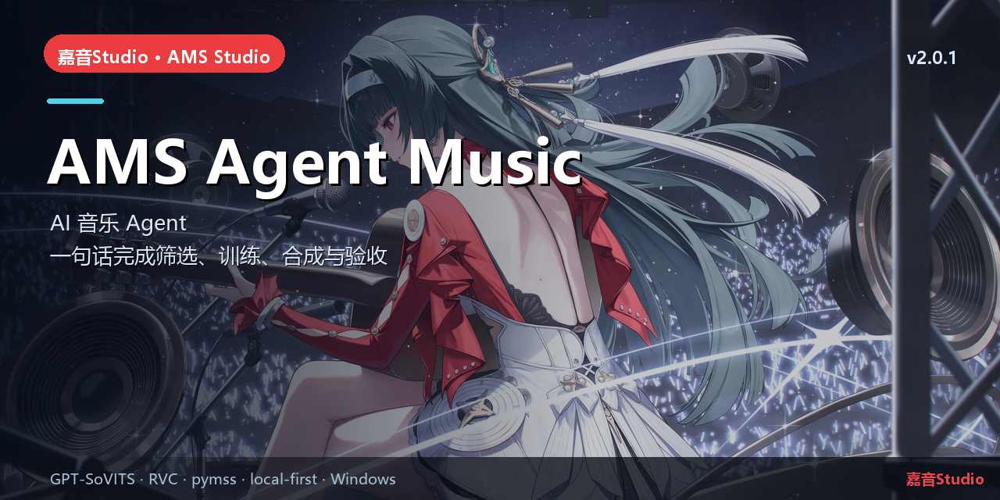

# AMS Agent Music

> 22 个本地工具 + Skill · 一句话完成音乐处理


## 简介

嘉音Studio 的音乐 Agent 插件。它在 Kernel 内加载 **22 个 `ams_*` 工具 + `ams-music-processing` Skill**，
让 AI 能安全地巡检/审计数据集、提交 GPU 任务、训练 RVC/GPT-SoVITS 音色、合成/试听、评测、发布前自检。

默认只读；写操作要求 `confirm=true`，删除只进 `data/trash`，没有 shell。

## 核心能力

- 数据集审计（时长/静音/削波/重复/缺文本/语气词）与精确文件清理。
- RVC 炼制/换源、pymss 分离、混音、评测、本地 ASR。
- GPT-SoVITS：`ams_tts_gsv_status/voices/synthesize/train/dataset_prepare`。
- 一键“先报告、再执行”；Skill 说明路由、工具契约、安全边界。

## 本仓库

```text
src/index.js        Host 工具与 Skill 注册
skills/            ams-music-processing Skill
client/            Kernel 换标/壁纸 client
mode/              “音乐制作”模式
bundle/            cordis.patch.yml
asr.py             本地 Vosk ASR 桥
```

## 快速开始

安装：启动器“安装插件到内核（音乐 + Agent）”，或把 0.3.1 tgz 安装到 Kernel profile。
使用：新建会话 → 模式选“音乐制作” → 直接描述需求，例如：
> 先列出音源、TTS 音色、数据集和工程，再对数据集做一次只读审计报告。

## 相关链接

- 总仓库：[yan-mc/AMS-Studio](https://github.com/yan-mc/AMS-Studio)
- 最新发布：[yan-mc/ams-release releases](https://github.com/yan-mc/ams-release/releases)
- 当前版本：**嘉音Studio v2.0.1**（feed 2058）
- 文档：[ams-docs](https://github.com/yan-mc/ams-docs)

## 说明

- 所有音乐数据默认留在安装目录 `data/`；Gateway 只监听 `127.0.0.1`。
- 本项目为本地优先工具，不提供云端上传；使用第三方模型/音频时请遵守各自许可。
- License: 项目自有代码按仓库声明；Vosk/DSH 等第三方依赖遵循各自许可证。
